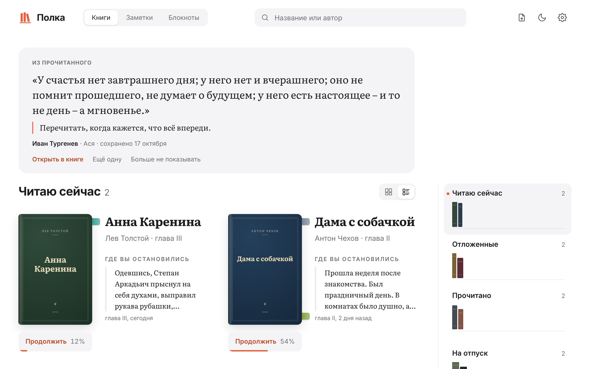
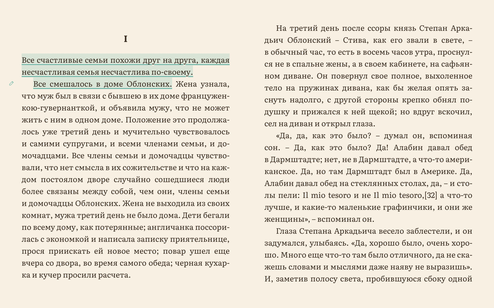
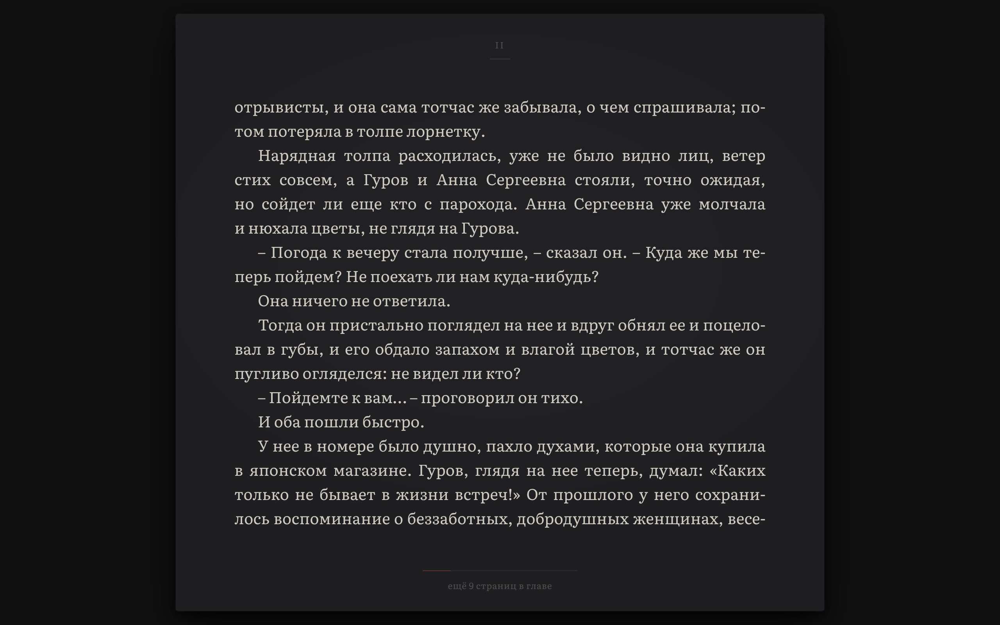
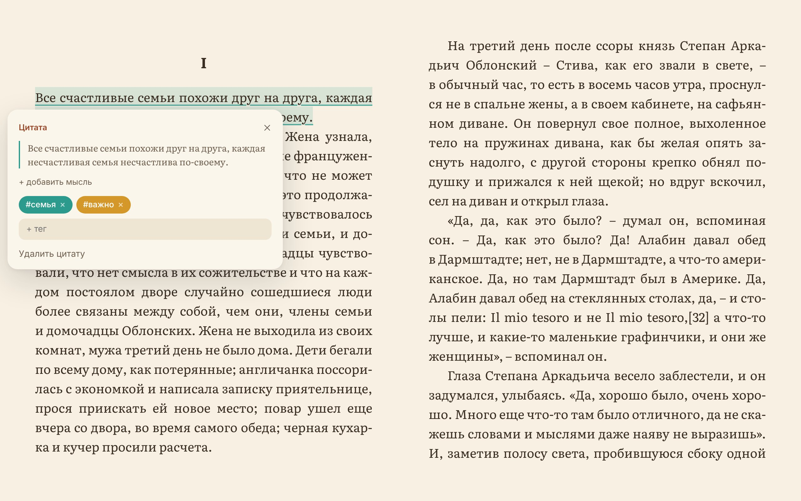
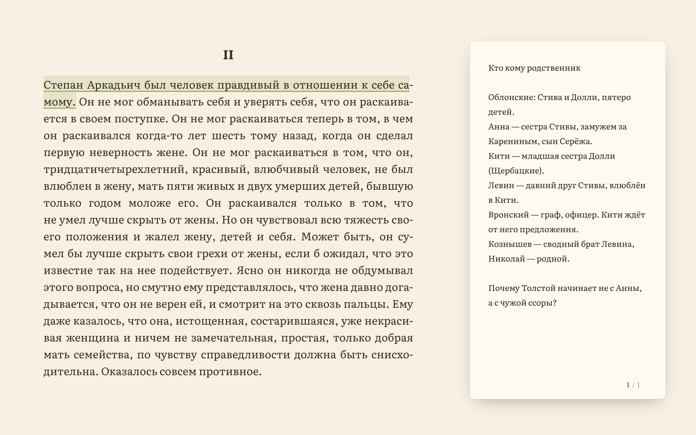
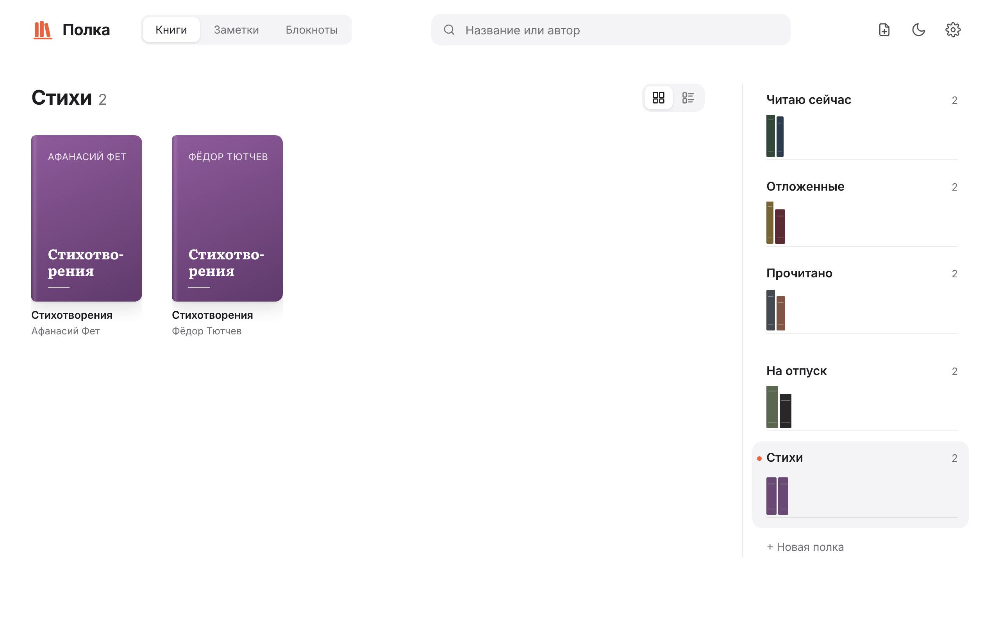
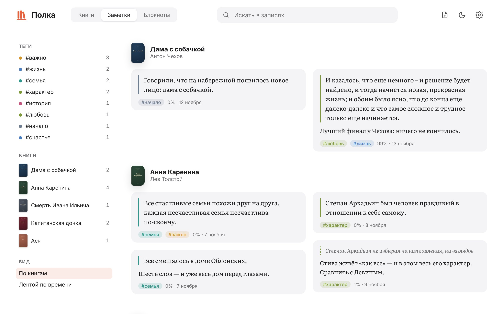

<div align="center">


# Полка

**Тихая читалка FB2 и EPUB для Windows.**<br>
Без рекламы, регистрации и облака — только вы и книга.

[**Скачать для Windows**](https://github.com/thepoluhin/polka/releases/latest) · [Что нового](https://github.com/thepoluhin/polka/releases) · [Как устроено](#как-устроено)

<sub>Windows 10 и 11, 64 бита · бесплатно · исходный код открыт</sub>

<br>



</div>

## Зачем ещё одна читалка

Большинство читалок либо выглядят как бухгалтерская программа, либо хотят аккаунт, синхронизацию и статистику. «Полка» сделана для одного: чтобы читать было приятно. Во время чтения на экране только текст — панели появляются, когда вы к ним тянетесь, и сами исчезают.

Всё, что вы отмечаете в книгах, остаётся вашим: цитаты, мысли и блокноты «Полка» тихо пишет обычными текстовыми файлами в папку «Читательский дневник» рядом с книгами. Их можно открыть в любом редакторе, положить в облако — и через десять лет они будут читаться.

## Что умеет

<table>
<tr>
<td width="50%"></td>
<td width="50%"></td>
</tr>
<tr>
<td><b>Типографика как в хорошей книге.</b> Разворот или страница, переносы, висячая пунктуация, восемь шрифтов, пять тем — от белой до чёрной. Листание с поворотом страницы и тихим шелестом, если хочется.</td>
<td><b>«Лист» и фокус.</b> Текст ложится на лист бумаги посреди тёмного стола. Фокус на абзаце или предложении приглушает всё остальное. Автопрокрутка — со скоростью вашего чтения.</td>
</tr>
<tr>
<td></td>
<td></td>
</tr>
<tr>
<td><b>Цитаты и заметки.</b> Выделите фразу — сохраните её с цветными тегами и своей мыслью. Перевод и значение слова — тут же, по одному клику.</td>
<td><b>Блокнот к каждой книге.</b> Чистый лист сбоку, книга сдвигается, а не прячется. Кто кому родственник, о чём подумать потом. Клавиша <kbd>N</kbd>.</td>
</tr>
<tr>
<td></td>
<td></td>
</tr>
<tr>
<td><b>Полки, которые расставляются сами.</b> «Читаю сейчас», «Отложенные», «Прочитано» и свои полки. Стихи и всё, к чему возвращаетесь всю жизнь, можно держать отдельно, чтобы они не толпились в «Читаю сейчас».</td>
<td><b>Все заметки в одном месте.</b> Цитаты и мысли из всех книг с поиском и тегами; клик — и книга открыта ровно на этом месте. Раз в день «Полка» напомнит одну старую цитату.</td>
</tr>
</table>

И ещё: сноски во всплывающем окне, иллюстрации на весь экран, поиск по книге, закладки, оглавление, страница «Книга прочитана» с вопросом о том, что осталось с вами, встроенная книга-путеводитель. Работает с FB2, FB2.ZIP и EPUB, понимает папки с тысячами книг.

## Установка

1. Скачайте `Polka-Setup-<версия>.exe` со [страницы релизов](https://github.com/thepoluhin/polka/releases/latest).
2. Запустите. Права администратора не нужны: «Полка» ставится в ваш профиль.
3. Укажите папку с книгами — и всё.

> Установщик не подписан цифровой подписью, поэтому Windows может показать «Система Windows защитила ваш компьютер». Нажмите «Подробнее» → «Выполнить в любом случае».

Удаление через «Параметры → Приложения» убирает программу и все её служебные данные. **Книги и «Читательский дневник» не трогаются никогда.**

## Приватность

«Полка» ничего не отправляет: ни книги, ни записи, ни статистику — её просто нет. В интернет программа ходит только когда вы сами нажмёте «Перевод» (Google Translate) или «Значение» (Википедия и Викисловарь), и передаёт только выделенный фрагмент. Код из книг (EPUB бывает со скриптами) не выполняется: окно работает в песочнице с жёсткой политикой безопасности.

## Клавиши

| | |
|---|---|
| <kbd>←</kbd> <kbd>→</kbd> | листать |
| <kbd>T</kbd> | оглавление, закладки, заметки, цитаты |
| <kbd>B</kbd> | закладка |
| <kbd>N</kbd> · <kbd>Ctrl</kbd>+<kbd>N</kbd> | блокнот к книге |
| <kbd>Ctrl</kbd>+<kbd>F</kbd> · <kbd>F3</kbd> | поиск по книге |
| <kbd>Ctrl</kbd>+<kbd>+</kbd> · <kbd>Ctrl</kbd>+<kbd>−</kbd> | крупнее · мельче |
| <kbd>F</kbd> · <kbd>F11</kbd> | полный экран |
| <kbd>Пробел</kbd> | пауза автопрокрутки |
| <kbd>Esc</kbd> | закрыть окно, вернуться в библиотеку |
| <kbd>F1</kbd> | справка |

## Как устроено

Electron 45 и чистые HTML, CSS и JavaScript — без фреймворков. Собственный разбор FB2 и EPUB, вёрстка страниц на CSS-колонках, подсветки через CSS Custom Highlight API, переносы — словари TeX. Всё, включая шрифты и звук, собирается в один файл интерфейса.

```
src/        интерфейс: index.html, styles.css, parsers.js, app.js
electron/   главный процесс и мост к диску (sandbox, contextIsolation, CSP)
build/      сборка, установщик NSIS, книга-путеводитель
test/       автотесты на Playwright и в настоящем Electron
docs/       дизайн-код и снимки экрана
```

Сборка (Linux или WSL, Node.js 20+):

```bash
npm install
node build.js                                   # dist/app и dist/Полка.html
node build/pack-win.js electron-v45.2.1-win32-x64.zip
bash build/make-installer.sh                    # dist/Polka-Setup-<версия>.exe
```

`dist/Полка.html` — та же программа одним файлом: открывается в Edge или Chrome без установки.

Дизайн-код — цвета тем, шрифты, сетка, компоненты и то, чего мы не делаем, — в [docs/DESIGN.md](docs/DESIGN.md).

## Благодарности

Шрифты Literata, PT Serif, Lora, IBM Plex Serif и PT Sans (SIL OFL 1.1), [fflate](https://github.com/101arrowz/fflate) (MIT), [hyphen](https://github.com/ytiurin/hyphen) (ISC), звук перелистывания — из набора «RPG Audio» [Kenney](https://kenney.nl) (CC0).

## Лицензия

[MIT](LICENSE) — пользуйтесь, читайте, улучшайте.
