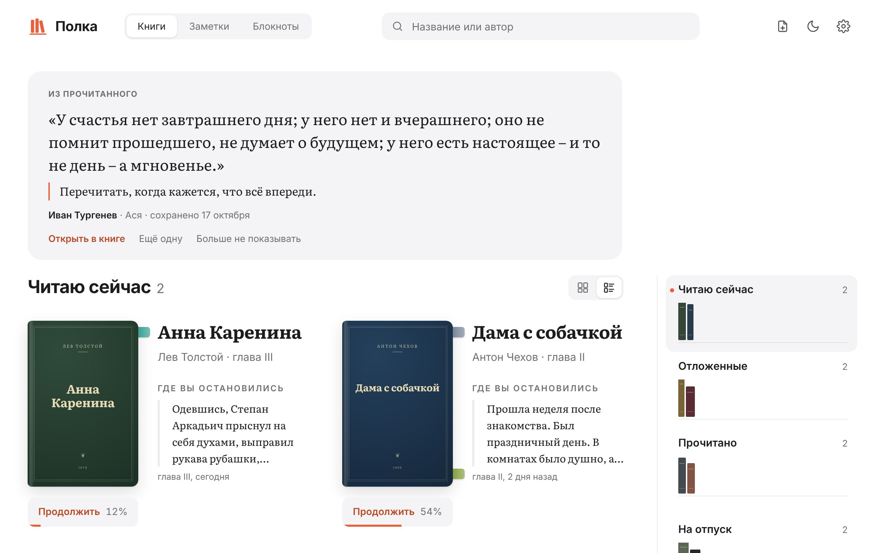

Первый публичный выпуск «Полки» — тихой читалки FB2 и EPUB для Windows.

## Установка

Скачайте **Polka-Setup-2.0.0.exe** ниже и запустите. Права администратора не нужны. Если браузер не даёт скачать `.exe`, возьмите тот же установщик в `.zip`.

Установщик не подписан, поэтому Windows может показать «Система Windows защитила ваш компьютер» → «Подробнее» → «Выполнить в любом случае».

Обновление с 1.x ставится поверх: книги, место чтения, цитаты, заметки и блокноты сохраняются.

## Что внутри

- **Чтение** — страница или разворот, «Лента», «Лист» на тёмном столе, фокус на абзаце или предложении, автопрокрутка. Переносы, висячая пунктуация, восемь шрифтов, пять тем. Панели появляются только когда к ним тянешься.
- **Цитаты и заметки** с цветными тегами, перевод и значение слова по выделению.
- **Блокнот к каждой книге** — чистый лист рядом с текстом (<kbd>N</kbd>), стрелки ходят по листам как по одной странице.
- **Полки** — «Читаю сейчас», «Отложенные», «Прочитано» и свои. Полку стихов можно держать отдельно от «Читаю сейчас».
- **Вкладки «Заметки» и «Блокноты»** — всё, что вы записали, во всех книгах, с поиском.
- **Читательский дневник** — все записи дублируются обычными Markdown-файлами рядом с книгами и остаются вашими.

## Что нового по сравнению с 1.14

**Надёжность**
- Книги с гигантскими абзацами без точек, китайский и японский текст больше не подвешивают окно.
- «Zip-бомба» в FB2.ZIP или EPUB не съедает память: файлы больше 256 МБ внутри архива не распаковываются.
- Одновременные записи в дневник больше не мешают друг другу.
- Испорченные настройки, полки или `state.json` не мешают запуску — мусор отбрасывается.
- Номер записи, поправленный вручную в файле дневника, не ломает синхронизацию.
- Открытие книги из проводника при уже запущенной «Полке» работает с относительными путями.

**Скорость**
- Первый поиск по книге — в 2–3 раза быстрее.
- Тихий пересмотр большой библиотеки — примерно вдвое быстрее.
- Установщик на 3,6 МБ меньше.

**Внешний вид**
- Контраст подписей и оранжевого текста подтянут до WCAG AA во всех пяти темах.
- Видимое кольцо фокуса для работы с клавиатуры во всех темах (и не загорается после клика мышью).
- Чёткие иконки на масштабе 125 % и 150 %.
- Строка состояния ровно по ширине текста, в «Листе» подписи встают на поля листа.
- На очень широких экранах главная держится по центру.

**Чистота**
- Обновление поверх старой версии полностью заменяет файлы программы.
- Удаление убирает все следы «Полки» в реестре и профиле, не трогая чужие программы для `.fb2` и `.epub`. Книги и «Читательский дневник» не удаляются никогда.

Полный дизайн-код — в [docs/DESIGN.md](https://github.com/thepoluhin/polka/blob/main/docs/DESIGN.md).
